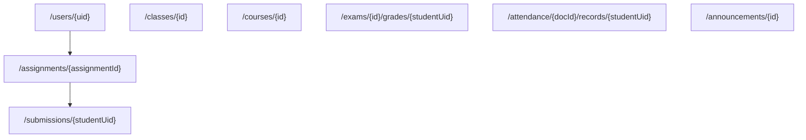

# 🎓 EduTrack — Ödev Takip ve Öğrenci Bilgi Sistemi (OBS)

EduTrack; üniversiteler ve eğitim kurumları için modern yazılım mühendisliği standartlarına uygun olarak geliştirilmiş, **Flutter** ve **Firebase** tabanlı bir **Ödev Takip ve OBS (Öğrenci Bilgi Sistemi)** mobil uygulamasıdır.

Sistem; klasik ödev teslimlerinin ötesinde, öğrencilerin yazılım projelerini doğrudan **GitHub Repository bağlantısı** ile teslim ettiği, **GitHub REST API** üzerinden commit geçmişi ve zaman damgalarının otomatik analiz edildiği, esnek **geç teslim politikaları** ve **rol tabanlı OBS yetkilendirmesi** sunan kapsamlı bir platformdur.

---

## 📑 İçindekiler
1. [Proje Vizyonu ve Temel Özellikler](#-proje-vizyonu-ve-temel-özellikler)
2. [Roller ve Yetki Matrisi](#-roller-ve-yetki-matrisi)
3. [Mimari Yapı (Clean Architecture + Feature-First)](#-mimari-yapı-clean-architecture--feature-first)
4. [Durum Yönetimi ve Reaktivite (Riverpod)](#-durum-yönetimi-ve-reaktivite-riverpod)
5. [Yönlendirme ve Güvenlik Muhafızları (GoRouter & Guards)](#-yönlendirme-ve-güvenlik-muhafızları-gorouter--guards)
6. [Çalışma Mantığı ve İş Kuralları](#-çalışma-mantığı-ve-iş-kuralları)
   - [6.1 GitHub Repo Teslim ve Commit Doğrulama](#61-github-repo-teslim-ve-commit-doğrulama)
   - [6.2 Geç Teslim Politikası (Late Policy Engine)](#62-geç-teslim-politikası-late-policy-engine)
   - [6.3 Teslim İnceleme, Commit Kanıtı ve Notlama](#63-teslim-inceleme-commit-kanıtı-ve-notlama)
   - [6.4 Yoklama ve Devamsızlık Takibi](#64-yoklama-ve-devamsızlık-takibi)
   - [6.5 Yönetici (Admin) Kontrol Paneli](#65-yönetici-admin-kontrol-paneli)
7. [Cloud Firestore Veri Modeli ve Güvenlik Kuralları](#-cloud-firestore-veri-modeli-ve-güvenlik-kuralları)
8. [Tasarım ve UI/UX Standartları (Nordic Dark Blue)](#-tasarım-ve-uiux-standartları-nordic-dark-blue)
9. [Proje Dizin Yapısı](#-proje-dizin-yapısı)
10. [Kurulum, Test ve Çalıştırma](#-kurulum-test-ve-çalıştırma)

---

## 🚀 Proje Vizyonu ve Temel Özellikler

* **GitHub Entegrasyonlu Teslim:** Öğrenciler projelerini GitHub public linki ile teslim eder. Sistem, son commit SHA'sını, commit sayısını ve son teslimden sonra commit atılıp atılmadığını tespit eder.
* **Geç Teslim Yönetimi:** Öğretmenler ödev başına `closed` (gecikmeye kapalı) veya `allowLate` (gecikmeye izinli, opsiyonel ceza puanı kesintili ve kesin kapanış tarihli) kurallar koyabilir.
* **Sunucu Zaman Damgası Güvencesi:** Kullanıcıların cihaz saatini değiştirerek hile yapmasını engellemek amacıyla tüm süre kontrolleri Firestore `request.time` (server timestamp) ile doğrulanır.
* **Kapsamlı OBS Modülleri:** Ders programı, vize/final sınav notları, not ortalaması (GNO), yoklama durumu ve duyuru merkezi.
* **Erişilebilirlik ve Navigasyon:** Tüm ekranlarda tutarlı geri butonu (`Icons.arrow_back_rounded`) mimarisi ve zenginleştirilmiş etkileşimler.

---

## 👥 Roller ve Yetki Matrisi

Sistem 3 temel aktör üzerine kurulmuştur:

| Yetki / Modül | 👨‍💼 Yönetici (Admin) | 👩‍🏫 Öğretmen (Teacher) | 👨‍🎓 Öğrenci (Student) |
|---|:---:|:---:|:---:|
| **Kullanıcı Yönetimi (CRUD)** | ✅ Tam Yetki | ❌ | ❌ |
| **Sınıf & Ders Tanımlama** | ✅ Tam Yetki | ❌ | ❌ |
| **Ödev Oluşturma & Düzenleme** | ❌ | ✅ Tam Yetki | ❌ |
| **Geç Teslim Politikası Belirleme** | ❌ | ✅ Tam Yetki | ❌ |
| **Ödev Teslimi Yapma (GitHub)** | ❌ | ❌ | ✅ Kendi Ödevleri |
| **Teslim İnceleme & Notlandırma** | ❌ | ✅ Kendi Dersleri | ❌ |
| **Yoklama Girişi** | ❌ | ✅ Kendi Dersleri | ❌ |
| **Not & Devamsızlık Görüntüleme** | ❌ | ❌ | ✅ Kendi Bilgileri |
| **Duyuru Yayınlama** | ✅ Genel Duyurular | ✅ Ders Duyuruları | ❌ Sadece Okuma |

---

## 🏛️ Mimari Yapı (Clean Architecture + Feature-First)

Uygulama, ölçeklenebilirliği ve test edilebilirliği en üst düzeye çıkaran **Feature-First Clean Architecture** prensibiyle inşa edilmiştir:

```
lib/
├── app/                  # Uygulama genel yapılandırması (Router, Theme, Constants)
├── core/                 # Ortak servisler, Hata yönetimi (Result), Utility ve Widget'lar
└── features/             # İşlevsel modüller (auth, assignments, submissions, home, users)
    └── [feature_name]/
        ├── data/         # Data Sources & Repository Uygulamaları
        ├── domain/       # Saf İş Mantığı (Entities & Repository Arayüzleri)
        └── presentation/ # UI Ekranları, Widget'lar ve Riverpod Provider'ları
```

### Katman Prensipleri:
1. **Domain Katmanı:** Flutter bağımlılığı içermeyen saf Dart kodudur. İş varlıklarını (`Entity`) ve sözleşmeleri (`Repository Interfaces`) barındırır.
2. **Data Katmanı:** Firebase Auth, Firestore ve GitHub REST API (Dio) ile konuşan `RemoteDataSource` ve bunları Domain sözleşmesine bağlayan `RepositoryImpl` sınıflarını içerir. Hatalar `Result.success` ve `Result.failure` sarmalayıcısı ile ele alınır.
3. **Presentation Katmanı:** Riverpod `Notifier` ve `Provider`ları aracılığıyla UI durumunu yöneten ve Material 3 bileşenlerini render eden katmandır.

---

## ⚡ Durum Yönetimi ve Reaktivite (Riverpod)

Projede `flutter_riverpod` kullanılmıştır. State yönetiminin ana hatları:

* **Kimlik Durumu (`auth_providers.dart`):**
  * `authStateChangesProvider`: Firebase Auth oturum akışını dinler.
  * `currentUserProfileProvider`: Giriş yapan kullanıcının Firestore `users/{uid}` profilini dinleyen reaktif bir `StreamProvider`dır.
  * `demoUserProvider`: Firebase olmadan çevrimdışı hızlı test ve prototipleme için anında rol geçişi sağlayan `DemoUserNotifier`.
* **Ödev ve Teslim Durumları (`assignment_providers.dart`, `submissions_providers.dart`):**
  * Ödev filtrelemeleri, teslim durumları ve GitHub analiz sonuçları immutable state yapıları üzerinden yönetilir.

---

## 🛡️ Yönlendirme ve Güvenlik Muhafızları (GoRouter & Guards)

Sayfa yönlendirmeleri [app_router.dart](file:///c:/Users/FAHRIASUS/Desktop/edutrack_app/lib/app/router/app_router.dart) içerisinde tanımlanan `GoRouter` ile deklaratif olarak yönetilir.

### Redirect (Yönlendirme Muhafızı) Mantığı:
1. Kullanıcı oturum açmamışsa otomatik olarak `/login` rotasına yönlendirilir.
2. Kullanıcı oturum açtığında, `currentUserProfileProvider`'dan gelen `role` değerine göre ilgili kabuğa (shell) yönlendirilir:
   * `UserRole.admin` ➡️ `/admin`
   * `UserRole.teacher` ➡️ `/teacher`
   * `UserRole.student` ➡️ `/student`
3. Bir kullanıcı URL manipülasyonu ile yetkisi dışındaki bir sayfaya erişmeye çalışırsa (örneğin öğrencinin `/admin` sayfasına gitmesi), router muhafızı bunu engeller ve kendi ana paneline geri döndürür.

---

## ⚙️ Çalışma Mantığı ve İş Kuralları

### 6.1 GitHub Repo Teslim ve Commit Doğrulama
Öğrenci bir ödevi teslim etmek istediğinde `https://github.com/<owner>/<repo>` formatında bir açık kaynak repo linki girer:
1. **URL Doğrulama:** [github_url_parser.dart](file:///c:/Users/FAHRIASUS/Desktop/edutrack_app/lib/core/utils/github_url_parser.dart) ile repository sahibi ve adı ayrıştırılır.
2. **GitHub REST API Sorgusu:** Uygulama GitHub API'sine (`/repos/{owner}/{repo}/commits`) istek atarak:
   * Toplam commit sayısını,
   * İlk ve son commit zaman damgalarını,
   * Son commit SHA hash'ini (`latestCommitSha`),
   * Son teslim tarihinden (`dueAt`) sonra commit yapılıp yapılmadığını (`commitsAfterDeadline`) çıkarır.
3. **Kullanıcı Adı Denetimi:** Teslim edilen deponun sahibi ile öğrencinin profilindeki GitHub kullanıcı adı eşleşmiyorsa sistem arayüzde bir uyarı rozeti gösterir.
4. **Hile Önleme:** Commit tarihleri manipüle edilebilir (`GIT_COMMITTER_DATE`). Bu sebeple resmi teslim saati her zaman Firestore `request.time` (sunucu saati) olarak kaydedilir; commit saatleri ise destekleyici kanıt olarak incelenir.

### 6.2 Geç Teslim Politikası (Late Policy Engine)
Öğretmen ödev oluştururken [create_assignment_screen.dart](file:///c:/Users/FAHRIASUS/Desktop/edutrack_app/lib/features/assignments/presentation/screens/create_assignment_screen.dart) üzerinden iki ana politikadan birini seçer:
* **`closed` (Geç Teslime Kapalı):** Son teslim tarihi (`dueAt`) geçtiği anda öğrenci ekranındaki teslim butonu kilitlenir ve Firestore Güvenlik Kuralları yeni teslimleri kesin olarak reddeder.
* **`allowLate` (Geç Teslim Kabul Edilir):** Süre bitse dahi öğrenciler teslim yapabilir.
  * Teslim anında sistem `isLate = true` damgası vurur.
  * Varsa `latePenaltyPercent` (örn: %20) notlama ekranına yansıtılır.
  * Varsa `lateUntil` (kesin kapanış tarihi) dolduğunda teslimler tamamen kapatılır.

### 6.3 Teslim İnceleme, Commit Kanıtı ve Notlama
Öğretmen [submission_review_screen.dart](file:///c:/Users/FAHRIASUS/Desktop/edutrack_app/lib/features/submissions/presentation/screens/submission_review_screen.dart) ekranında:
* Öğrencinin GitHub repo linkini tek tıkla tarayıcıda açabilir.
* Commit SHA, son commit tarihi ve gecikme durumunu inceler.
* 100 üzerinden puan verir; geç teslim varsa sistem ceza kesintisini otomatik hesaplayıp öğretmene net puanı önerir.
* Geri bildirim notu ekleyerek değerlendirmeyi kaydeder.

### 6.4 Yoklama ve Devamsızlık Takibi
* Öğretmen, kayıtlı dersleri için tarih bazlı yoklama oturumu açar; öğrencileri "Var", "Yok", "İzinli" olarak işaretler.
* Öğrenci, dönemlik devamsızlık hakkını ve kalan devamsızlık gün sayısını dairesel ilerleme çubukları ile anlık takip eder.

### 6.5 Yönetici (Admin) Kontrol Paneli
Yönetici ekranı [admin_shell_screen.dart](file:///c:/Users/FAHRIASUS/Desktop/edutrack_app/lib/features/home/presentation/screens/admin_shell_screen.dart) 5 ana sekmeden oluşur:
1. **Özet (Bento Grid):** Sistem istatistikleri (Öğrenci, Öğretmen, Sınıf, Ders sayıları), 4 hızlı yönetim butonu ve Firestore/API durum monitörü.
2. **Kullanıcı Yönetimi:** Rol filtreli ve aramalı kullanıcı listesi; yeni kullanıcı oluşturma ve silme onay diyaloğu.
3. **Sınıf Yönetimi:** Şube, düzey ve kontenjan bazlı sınıf oluşturma/silme.
4. **Ders Yönetimi:** Ders kodu, AKTS kredisi ve öğretim görevlisi ataması.
5. **Duyuru Merkezi:** Tüm okula veya belirli rollere yönelik anlık duyuru yayınlama.

---

## 🔒 Cloud Firestore Veri Modeli ve Güvenlik Kuralları

Tüm veritabanı erişimi [firestore.rules](file:///c:/Users/FAHRIASUS/Desktop/edutrack_app/firestore.rules) ile sunucu tarafında doğrulanır:



### Güvenlik Kuralları Öne Çıkanlar:
* **Ödev Teslim Koruması:** Öğrenci yalnızca kendi `uid`'si altına teslim yapabilir.
* **Geç Teslim Validasyonu:** Kural fonksiyonu `windowOpen()`, teslim anındaki `request.time`'ın `dueAt` veya `lateUntil` sınırlarını aşıp aşmadığını kontrol eder.
* **Puan Koruma:** Öğrenci teslim oluştururken veya güncellerken `score` alanını değiştiremez; not yazma yetkisi sadece `isTeacher()` için geçerlidir.

---

## 🎨 Tasarım ve UI/UX Standartları (Nordic Dark Blue)

Uygulama, modern **Nordic Minimalist Dark** tasarım diliyle geliştirilmiştir:
* **Renk Paleti ([app_colors.dart](file:///c:/Users/FAHRIASUS/Desktop/edutrack_app/lib/app/theme/app_colors.dart)):**
  * `primary`: `#00F5A0` (Neon Nane Yeşili)
  * `secondary`: `#00D9F5` (Okyanus Camgöbeği)
  * `accent`: `#F5A623` (Kehribar / Uyarı)
  * `background`: `#0A0F1D` (Koyu Gece Mavisi)
  * `surface`: `#111827` & `surfaceHigh`: `#1E293B`
* **Tipografi:** Google Fonts `Plus Jakarta Sans` ile güçlü hiyerarşi ve yüksek okunabilirlik.
* **Özel Bileşenler:**
  * [bouncy_card.dart](file:///c:/Users/FAHRIASUS/Desktop/edutrack_app/lib/core/widgets/bouncy_card.dart): Mikro animasyonlu basma efektine (`scale: 0.975`) sahip dokunsal kartlar.
  * [zigzag_chart.dart](file:///c:/Users/FAHRIASUS/Desktop/edutrack_app/lib/core/widgets/zigzag_chart.dart): Özel `CustomPainter` ile çizilen başarı ve trend grafiği.
  * [sweet_progress_bar.dart](file:///c:/Users/FAHRIASUS/Desktop/edutrack_app/lib/core/widgets/sweet_progress_bar.dart): Gradyan dolgulu modern ilerleme çubukları.

---

## 📂 Proje Dizin Yapısı

```
edutrack_app/
├── lib/
│   ├── app/
│   │   ├── router/          # GoRouter konfigürasyonu ve yönlendirme muhafızları
│   │   ├── theme/           # AppColors, AppSpacing ve AppTheme
│   │   └── app.dart         # MaterialApp.router ana kök bileşeni
│   ├── core/
│   │   ├── demo/            # Mock veriler (DemoData)
│   │   ├── error/           # Failure ve Result hata sarmalayıcıları
│   │   ├── firebase/        # Firebase instance provider'ları
│   │   ├── network/         # Dio HTTP client ve GitHub API servisi
│   │   ├── utils/           # Tarih formatlama, Validators, GitHub URL parser
│   │   └── widgets/         # BouncyCard, ZigzagChart, SweetProgressBar vb.
│   ├── features/
│   │   ├── assignments/     # Ödev listeleme, oluşturma ve politikalar
│   │   ├── auth/            # Giriş ekranı, Firebase Auth & Demo login
│   │   ├── home/            # Admin, Teacher ve Student Shell (Kabuk) ekranları
│   │   ├── submissions/     # GitHub teslimi ve öğretmen inceleme/notlama
│   │   └── users/           # AppUser varlığı ve profil servisleri
│   ├── firebase_options.dart
│   └── main.dart            # Uygulama giriş noktası
├── test/                    # Birim, widget, overflow ve buton testleri (52 test)
├── firestore.rules          # Firestore sunucu güvenlik kuralları
├── project.md               # Proje gereksinimleri ve yol haritası
└── pubspec.yaml             # Paket bağımlılıkları
```

---

## 🛠️ Kurulum, Test ve Çalıştırma

### Gereksinimler
* Flutter SDK (3.24+ önerilir)
* Dart SDK (3.5+)

### 1. Bağımlılıkları Yükleme
```bash
flutter pub get
```

### 2. Statik Kod Analizi (Linting)
```bash
flutter analyze
```

### 3. Testleri Çalıştırma
Tüm widget, overflow, geri butonu ve akış testlerini koşturmak için:
```bash
flutter test
```

### 4. Uygulamayı Başlatma
* **Chrome / Web üzerinde:**
  ```bash
  flutter run -d chrome
  ```
* **Android Cihaz veya Emülatörde:**
  ```bash
  flutter run -d android
  ```

> 💡 **Hızlı Giriş İpucu:** Uygulama açılış ekranında Firebase yapılandırması olmasa dahi tek tıkla deneyimleyebilmeniz için **"Öğrenci Olarak Gir"**, **"Öğretmen Olarak Gir"** ve **"Yönetici Olarak Gir"** hızlı demo butonları mevcuttur.
