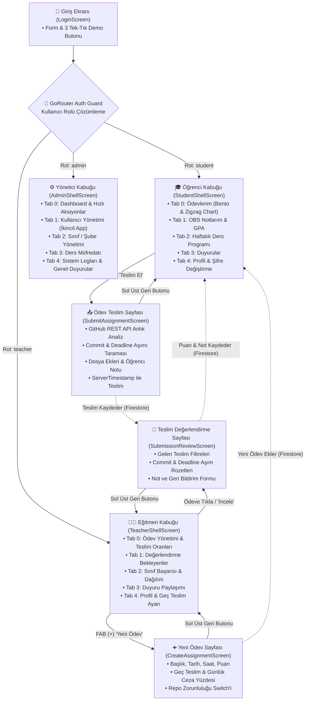

# 🎓 EduTrack — Akıllı Ödev, GitHub ve OBS Entegrasyonlu Akademik Takip Sistemi
## 📌 Jüri ve Proje Sunum Dokümanı (`sunu.md`)

> **Bu doküman;** EduTrack projesinin akademik jüriye, öğretim üyelerine veya değerlendirme komitesine sunulması amacıyla hazırlanmıştır. Projenin mimarisini, sayfaların birbiriyle olan çalışma ve veri alışveriş mantığını, kullanıcı rollerini, **tüm sayfalarda gerçekleşen bütün işlemleri (buton tıklamaları, form doğrulamaları, hesaplamalar, API ve veritabanı etkileşimleri)** ve sunum anında takip edilecek **canlı demo senaryosunu** en ince ayrıntısına kadar açıklar.

---

## 📑 İÇİNDEKİLER
1. [Projenin Amacı ve Çözdüğü Akademik Problem](#1-projenin-amacı-ve-çözdüğü-akademik-problem)
2. [Sistem Mimarisi ve Teknoloji Yığını](#2-sistem-mimarisi-ve-teknoloji-yığını)
3. [Kullanıcı Rolleri ve Yetki Matrisi](#3-kullanıcı-rolleri-ve-yetki-matrisi)
4. [Sayfaların Birbiriyle Çalışma Mantığı ve Veri Akış Şeması](#4-sayfaların-birbiriyle-çalışma-mantığı-ve-veri-akış-şeması)
5. [TÜM SAYFALARIN GERÇEKLEŞTİRDİĞİ İŞLEMLER (Detaylı Analiz)](#5-tüm-sayfaların-gerçekleştirdiği-işlemler-detaylı-analiz)
   - [5.1. Giriş ve Kimlik Doğrulama Ekranı (`LoginScreen`)](#51-giriş-ve-kimlik-doğrulama-ekranı-loginscreen)
   - [5.2. Öğrenci Portalı (`StudentShellScreen` — 5 Sekme)](#52-öğrenci-portalı-studentshellscreen--5-sekme)
     - [5.2.1. Sekme 0: Ödevlerim (Bento, Zigzag Chart & Bilet Kartları)](#521-sekme-0-ödevlerim-bento-zigzag-chart--bilet-kartları)
     - [5.2.2. Sekme 1: OBS Notlarım & Transkript](#522-sekme-1-obs-notlarım--transkript)
     - [5.2.3. Sekme 2: Haftalık Ders Programı](#523-sekme-2-haftalık-ders-programı)
     - [5.2.4. Sekme 3: Duyurular](#524-sekme-3-duyurular)
     - [5.2.5. Sekme 4: Profilim ve Güvenlik](#525-sekme-4-profilim-ve-güvenlik)
   - [5.3. Eğitmen Portalı (`TeacherShellScreen` — 5 Sekme)](#53-eğitmen-portalı-teachershellscreen--5-sekme)
     - [5.3.1. Sekme 0: Ödev Yönetimi & Teslim Oranları](#531-sekme-0-ödev-yönetimi--teslim-oranları)
     - [5.3.2. Sekme 1: Değerlendirme Bekleyenler Havuzu](#532-sekme-1-değerlendirme-bekleyenler-havuzu)
     - [5.3.3. Sekme 2: Sınıf Başarısı & İstatistikler](#533-sekme-2-sınıf-başarısı--istatistikler)
     - [5.3.4. Sekme 3: Duyuru Paylaşımı](#534-sekme-3-duyuru-paylaşımı)
     - [5.3.5. Sekme 4: Eğitmen Profili & Geç Teslim Ayarı](#535-sekme-4-eğitmen-profili--geç-teslim-ayarı)
   - [5.4. Yönetici Portalı (`AdminShellScreen` — 5 Sekme)](#54-yönetici-portalı-adminshellscreen--5-sekme)
     - [5.4.1. Sekme 0: Genel Bakış (Dashboard & Hızlı Aksiyonlar)](#541-sekme-0-genel-bakış-dashboard--hızlı-aksiyonlar)
     - [5.4.2. Sekme 1: Kullanıcı Yönetimi & İkincil FirebaseApp ile Kayıt](#542-sekme-1-kullanıcı-yönetimi--ikincil-firebaseapp-ile-kayıt)
     - [5.4.3. Sekme 2: Sınıf & Şube Yönetimi](#543-sekme-2-sınıf--şube-yönetimi)
     - [5.4.4. Sekme 3: Ders Müfredatı Yönetimi](#544-sekme-3-ders-müfredatı-yönetimi)
     - [5.4.5. Sekme 4: Sistem Logları & Genel Duyurular](#545-sekme-4-sistem-logları--genel-duyurular)
   - [5.5. Yeni Ödev Oluşturma Ekranı (`CreateAssignmentScreen`)](#55-yeni-ödev-oluşturma-ekranı-createassignmentscreen)
   - [5.6. Ödev Teslim ve GitHub İnceleme Ekranı (`SubmitAssignmentScreen`)](#56-ödev-teslim-ve-github-inceleme-ekranı-submitassignmentscreen)
   - [5.7. Teslim Değerlendirme ve Notlandırma Ekranı (`SubmissionReviewScreen`)](#57-teslim-değerlendirme-ve-notlandırma-ekranı-submissionreviewscreen)
6. [Ortak Bileşenlerin (Widgets) Rolleri ve İşlevleri](#6-ortak-bileşenlerin-widgets-rolleri-ve-işlevleri)
7. [Öne Çıkan 5 Mühendislik Yeteneği (Jüriye Vurgulanacaklar)](#7-öne-çıkan-5-mühendislik-yetenegi-jüriye-vurgulanacaklar)
8. [Canlı Sunum Senaryosu (Adım Adım Demo Rehberi)](#8-canlı-sunum-senaryosu-adım-adım-demo-rehberi)

---

## 1. Projenin Amacı ve Çözdüğü Akademik Problem

Üniversitelerde yazılım, bilgisayar mühendisliği ve teknik bölümlerde ödev yönetimi genellikle iki parçalı ve hantal bir süreçtir:
1. **LMS / OBS Sistemleri:** Yalnızca zip/pdf yüklenmesine izin verir; kodun kalitesini, git geliştirme disiplinini ve öğrencinin ödevi son günde mi yoksa zamana yayarak mı yaptığını denetleyemez.
2. **GitHub Classroom / Harici Git:** Notlandırma ve öğrenci ders durumunu üniversitenin resmi not sistemiyle (vize, final, ağırlıklı ortalama, harf notu) bağdaştıramaz.

### 💡 EduTrack'in Getirdiği Çözüm:
* **Akıllı GitHub REST API Analizi:** Öğrencinin teslim ettiği GitHub reposundaki commit geçmişini, teslim tarihinden sonra yapılan yetkisiz commitleri (`commitsAfterDeadline`) ve ilk/son geliştirme anlarını anlık analiz eder.
* **Geç Teslim Politikası Motoru:** Cezalı teslim (`allowLate` ile günlük % ceza kesintisi ve ek mühlet) ve kesin son tarih (`closed`) mantığını otomatik denetler.
* **Entegre OBS & Ders Programı:** Öğrencinin aldığı dersleri, haftalık laboratuvar saatlerini ve dönemlik akademik notlarını tek bir panelde birleştirir.
* **Rol Tabanlı Güvenlik:** Öğrenci, Eğitmen ve Sistem Yöneticisi için izole edilmiş arayüzler ve yetki kontrolleri sunar.

---

## 2. Sistem Mimarisi ve Teknoloji Yığını

EduTrack, endüstri standardı **Clean Architecture** (Katmanlı Mimari) ve **Feature-First** klasörleme prensibiyle geliştirilmiştir:

```
lib/
├── app/                  # Uygulama kökü, GoRouter yönlendirme ve Material 3 Koyu Mavi Tema
├── core/                 # Çekirdek yardımcılar (Validators, DateUtils, Result, Failure, Ortak Widget'lar)
└── features/             # Özellik bazlı Clean Architecture modülleri
    ├── auth/             # Giriş, profil, ikincil Firebase oturumu, yetkilendirme
    ├── assignments/      # Ödev oluşturma, listeleme, detay, ceza politikası
    ├── submissions/      # Ödev teslim etme, dosya ekleme, hoca notlandırması
    ├── github/           # GitHub REST API, commit analizi, URL ayrıştırma
    ├── home/             # Öğrenci, Eğitmen ve Admin 5'er sekmeli ana kabukları
    └── users/            # Kullanıcı modelleri ve rol yönetimi
```

* **Frontend:** Flutter 3.x (Material 3 Koyu Mavi `0xFF0A0E17` soft neon tasarım sistemi)
* **Durum Yönetimi:** Riverpod 2.x (StateNotifierProvider, StreamProvider, FutureProvider)
* **Navigasyon & Koruma:** GoRouter (Otomatik rol yönlendirmesi ve Auth Guard)
* **Veritabanı & Auth:** Firebase Authentication & Cloud Firestore (Gerçek zamanlı Snapshot akışları)
* **Harici Ağ İletişimi:** Dio (GitHub v3 REST API Client)
* **Test & Kalite:** 52/52 Birim ve Widget Test Kapsamı, 0 `flutter analyze` hatası.

---

## 3. Kullanıcı Rolleri ve Yetki Matrisi

| Rol | Rota Yetkisi | Temel İşlemleri |
| :--- | :--- | :--- |
| **Öğrenci (Student)** | `/student`, `/student/submit/:id` | Ödevleri inceleme, GitHub reposu bağlama, commit analizini izleme, dosya ekleme, teslim gönderme, OBS notlarını ve ders programını görüntüleme. |
| **Eğitmen (Teacher)** | `/teacher`, `/teacher/create-assignment`, `/teacher/review/:id` | Yeni ödev açma, geç teslim cezası belirleme, sınıfa gelen teslimleri listeleme, commit geçmişini denetleme, puan ve geri bildirim girme. |
| **Yönetici (Admin)** | `/admin` | Yeni hoca/öğrenci kullanıcıları açma, sınıf/şube oluşturma, ders müfredatı tanımlama, sistem duyuruları ve denetim loglarını yönetme. |

---

## 4. Sayfaların Birbiriyle Çalışma Mantığı ve Veri Akış Şeması

EduTrack sayfaları bağımsız çalışan statik ekranlar değil; ortak veri sağlayıcıları (Riverpod Providers) ve Firebase gerçek zamanlı akışları üzerinden birbiriyle konuşan dinamik bir ekosistemdir:



---

## 5. TÜM SAYFALARIN GERÇEKLEŞTİRDİĞİ İŞLEMLER (Detaylı Analiz)

### 5.1. Giriş ve Kimlik Doğrulama Ekranı (`LoginScreen`)
* **Rota:** `/login`
* **Görünüm Amacı:** Kullanıcının sisteme güvenli giriş yapmasını sağlamak veya sunum anında tek tıkla rolleri test etmek.
* **Bu Sayfada Yapılan Tüm İşlemler:**
  1. **E-posta Girişi ve Doğrulama:** `TextFormField` üzerinde `Validators.email` çalışır; `@` işareti, geçerli domain ve boşluk kontrolleri anlık yapılır.
  2. **Şifre Girişi ve Gizleme:** Şifre gizleme/gösterme (göz ikonu) butonu ile metin maskelenir; `Validators.password` ile en az 6 karakter kontrolü uygulanır.
  3. **"Giriş Yap" Butonu Tıklaması:**
     - Form doğrulaması (`_formKey.currentState!.validate()`) tetiklenir.
     - `authControllerProvider` üzerinden `signInWithEmailAndPassword` çağrılır.
     - Giriş işlemi sürerken buton içinde `CircularProgressIndicator` döner.
     - Hatalı şifre veya bulunamayan hesap durumunda Türkçe hata mesajı (SnackBar) gösterilir.
  4. **3 Adet Tek Tık Hızlı Demo Girişi (Jüri Dostu Butonlar):**
     - 🎓 **Öğrenci Butonu:** `authController.signInWithDemo('ogrenci@edutrack.com', 'student123')` tetikler.
     - 👨‍🏫 **Öğretmen Butonu:** `authController.signInWithDemo('ogretmen@edutrack.com', 'teacher123')` tetikler.
     - ⚙️ **Admin Butonu:** `authController.signInWithDemo('admin@edutrack.com', 'admin123')` tetikler.
  5. **Rol Tabanlı Otomatik Yönlendirme:** Giriş tamamlandığında Firebase'deki `users/{uid}` kaydı okunur; `AppRouter` tetiklenerek kullanıcı ilgili kabuğa (`/student`, `/teacher`, `/admin`) yönlendirilir.
  6. **Sol Üst Geri Butonu:** Kullanıcı uygulamayı kapatmak veya önceki ekrana dönmek istediğinde güvenli geri dönüş sağlar.

---

### 5.2. Öğrenci Portalı (`StudentShellScreen` — 5 Sekme)
* **Rota:** `/student`
* **Görünüm Amacı:** Öğrencinin ödevlerini, notlarını, ders programını ve profilini tek bir mobil arayüzden yönetmesi.
* **Sol Üst Akıllı Geri Butonu İşlemi:** Eğer öğrenci sekme 1, 2, 3 veya 4'teyse butona basıldığında önce ana sekme olan Sekme 0'a (Ödevlerim) döner. Zaten Sekme 0'daysa onay dialogu açarak güvenli çıkış / login ekranına yönlendirir.

#### 5.2.1. Sekme 0: Ödevlerim (Bento, Zigzag Chart & Bilet Kartları)
* **Arama ve Filtreleme:** Arama çubuğu ile ödev başlığı veya ders adına göre dinamik filtreleme yapılır. "Tümü", "Açık", "Süresi Geçti", "Teslim Edildi" durum çipleriyle liste filtrelenir.
* **Bento İstatistik Kartları:** Toplam ödev sayısı, teslim edilen ödev sayısı ve kalan ödev adedi anlık hesaplanarak renkli bento kartlarda sunulur.
* **Neon Zigzag Performans Grafiği (`ZigzagChartWidget`):** Öğrencinin teslim ettiği son ödevlerden aldığı notların dalgalanmasını CustomPainter ile çizer; ortalama performans puanı (örn: 89.5) rozetle gösterilir.
* **Yatay Ödev Vitrini (Carousel — `AssignmentVerticalCard`):** Teslim tarihi yaklaşan ödevler yatay kaydırılabilir kartlar halinde aciliyet rozetleriyle sergilenir.
* **Bilet Formatında Ödev Kartları (`AssignmentTicketCard`):**
  - Ödev başlığı, ders adı, son teslim tarihi.
  - `DeadlineBadge`: Son 24 saat uyarısı, kalan gün/saat veya "Süresi Geçti" durumu.
  - Alınan not ve teslim durumu çipi (`StatusChip`).
* **Ödeve Tıklama İşlemi:** Bir ödeve tıklandığında `context.push('/student/submit/${assignment.id}')` ile **Ödev Teslim Ekranı** açılır.

#### 5.2.2. Sekme 1: OBS Notlarım & Transkript
* **Ders Notu Kartları:** Öğrencinin aldığı CENG301, CENG302, CENG303, CENG304 gibi derslerin Vize, Ödev ve Final notları ayrı ayrı listelenir.
* **Otomatik Ağırlıklı Ortalama Hesabı:**
  $$\text{Dönem Notu} = (\text{Vize} \times 0.30) + (\text{Ödev} \times 0.20) + (\text{Final} \times 0.50)$$
* **Harf Notu Matrisi:** Puan aralığına göre (AA, BA, BB, CB, CC, DC, DD, FF) harf notu renkli rozetle gösterilir.
* **Genel Not Ortalaması (GPA / Transkript):** Tüm derslerin ortalaması alınarak öğrencinin genel dönem başarı puanı (örn: 3.42 / 4.00) kart olarak özetlenir.

#### 5.2.3. Sekme 2: Haftalık Ders Programı
* **Zaman Çizelgesi:** Pazartesi - Cuma günleri arasındaki ders saatleri bloklar halinde gösterilir (örn: 09:00 - 11:50).
* **Derslik ve Eğitmen Bilgisi:** Her ders için derslik kodu (örn: Lab 302, Derslik B-12) ve dersi yürüten öğretim üyesi adı yer alır.

#### 5.2.4. Sekme 3: Duyurular
* **Duyuru Listesi:** Bölüm başkanlığı ve ders öğretmenleri tarafından yayınlanan duyurular kronolojik olarak gösterilir.
* **Duyuru Detayı:** Başlık, duyuru metni, yazar adı ve yayınlanma tarihi formatlanmış olarak okunur.

#### 5.2.5. Sekme 4: Profilim ve Güvenlik
* **Profil Bilgileri:** Öğrencinin adı-soyadı, e-posta adresi, OBS öğrenci numarası (örn: 2024101), kayıtlı sınıfı ve bağlı GitHub kullanıcı adı rozeti.
* **Şifre Değiştirme Butonu:** Tıklandığında modal açılır; yeni şifre girilerek `authRepository.updatePassword` ile Firebase Auth üzerinde güncellenir.
* **Oturumu Kapat Butonu:** `authRepository.signOut()` çağrılarak aktif oturum sonlandırılır ve `/login` sayfasına yönlendirilir.

---

### 5.3. Eğitmen Portalı (`TeacherShellScreen` — 5 Sekme)
* **Rota:** `/teacher`
* **Görünüm Amacı:** Eğitmenin sorumlu olduğu derslerin ödevlerini açması, teslim oranlarını izlemesi ve gelen projeleri değerlendirmesi.
* **Sol Üst Geri Butonu:** Sekmeler arası geri dönüş veya oturum kapatma kontrolü sağlar.
* **Sağ Alttaki FAB (+) Butonu:** Tıklandığında doğrudan `/teacher/create-assignment` (Yeni Ödev Oluşturma) ekranına götürür.

#### 5.3.1. Sekme 0: Ödev Yönetimi & Teslim Oranları
* **Bento İstatistik Kartları:** Açılan toplam ödev, incelenen teslimler ve notlandırma bekleyen öğrenci sayıları.
* **Ödev Arama:** Ödev adına ve ders koduna göre anlık arama.
* **Ödev Kartları:**
  - Ödev başlığı, ders adı, son teslim tarihi.
  - Teslim Oranı Çubuğu (`SweetProgressBar`): Örn. "42 öğrenciden 28'i teslim etti (%66.6)" dinamik doluluk çubuğu.
  - Ödev Durumu Çipi (`StatusChip`: Açık, Süresi Doldu, Kapalı).
* **Ödeve Tıklama İşlemi:** Ödev kartına basıldığında o ödeve gelen teslimleri değerlendirmek üzere `/teacher/review/${assignment.id}` ekranına gidilir.

#### 5.3.2. Sekme 1: Değerlendirme Bekleyenler Havuzu
* **Acil İnceleme Listesi:** Sorumlu olunan tüm ödevler taranarak henüz puan verilmemiş (`score == null`) öğrenci teslimleri tek bir havuzda listelenir.
* **Hızlı Geçiş:** Eğitmen bekleyen bir öğrenciye tıkladığında doğrudan o ödevin değerlendirme ekranına odaklanır.

#### 5.3.3. Sekme 2: Sınıf Başarısı & İstatistikler
* **Başarı Analizi:** Ödevlerin ve derslerin sınıf genelindeki ortalama notları, en yüksek not, en düşük not ve not dağılım grafiği özetlenir.

#### 5.3.4. Sekme 3: Duyuru Paylaşımı
* **Duyuru Gönderme Butonu:** Modal pencere açarak başlık, açıklama ve hedef sınıf seçimi ile anında sınıfa duyuru gönderilmesini sağlar; kaydedilen duyuru öğrencilerin ekranına anında düşer.

#### 5.3.5. Sekme 4: Eğitmen Profili & Geç Teslim Ayarı
* **Eğitmen Bilgileri:** Ad-soyad, unvan, e-posta ve sorumlu olunan dersler.
* **Varsayılan Geç Teslim Tercihi:** Eğitmenin yeni açacağı ödevlerde varsayılan olarak "Cezalı Teslim" (`allowLate`) mi yoksa "Kesin Kilitlenme" (`closed`) mi uygulanacağını seçtiği profil ayarı.
* **Şifre Değiştirme ve Çıkış:** Güvenli şifre yenileme ve oturum kapatma butonları.

---

### 5.4. Yönetici Portalı (`AdminShellScreen` — 5 Sekme)
* **Rota:** `/admin`
* **Görünüm Amacı:** Üniversite sistem yöneticisinin tüm sistemi, kullanıcıları, sınıfları, dersleri ve denetim loglarını kontrol etmesi.
* **Sol Üst Geri Butonu:** Sekmeler arası geri dönüş ve oturum kapatma kontrolü sunar.

#### 5.4.1. Sekme 0: Genel Bakış (Dashboard & Hızlı Aksiyonlar)
* **Sistem Metrikleri:** Toplam öğrenci, toplam eğitmen, aktif sınıf ve müfredattaki ders sayıları.
* **Tıklanabilir Bento Kartlar:**
  - Öğrenci kartına tıklandığında Sekme 1'e geçer ve filtreyi 'Öğrenci' yapar.
  - Eğitmen kartına tıklandığında Sekme 1'e geçer ve filtreyi 'Eğitmen' yapar.
  - Sınıf kartına tıklandığında Sekme 2'ye (Sınıflar) geçer.
  - Ders kartına tıklandığında Sekme 3'e (Dersler) geçer.
* **Hızlı Aksiyon Butonları (Quick Actions Grid):**
  - **"Öğrenci Ekle":** Öğrenci oluşturma modalını tek tıkla açar.
  - **"Öğretmen Ekle":** Eğitmen oluşturma modalını açar.
  - **"Sınıf Aç":** Yeni sınıf ve şube tanımlama modalını açar.
  - **"Ders Tanımla":** Yeni ders açma modalını açar.

#### 5.4.2. Sekme 1: Kullanıcı Yönetimi & İkincil FirebaseApp ile Kayıt
* **Arama & Filtreleme:** İsim, e-posta veya okul numarasına göre anlık arama; "Tümü", "Öğrenci", "Eğitmen", "Admin" filtre çipleri.
* **Yeni Kullanıcı Ekleme FAB (+) Butonu:**
  - Form alanları: Ad-Soyad, E-posta, Şifre, Rol (Öğrenci/Eğitmen/Admin), Okul No, Sınıf seçimi.
  - **İkincil FirebaseApp İzolasyonu:** Admin oturumunun düşmesini engellemek için arka planda `Firebase.initializeApp(name: 'admin-temp-...')` geçici nesnesi açılır, `createUserWithEmailAndPassword` ile kullanıcı oluşturulur, çıkış yapılıp geçici app silinir.
  - Kullanıcı bilgileri Firestore `users/{uid}` dökümanına `FieldValue.serverTimestamp()` ile kaydedilir.
* **Kullanıcı Silme Butonu:** Çöp kutusu butonuna basıldığında onay dialogu açılır; onay verildiğinde kullanıcı veritabanından silinir ve liste anında güncellenir.

#### 5.4.3. Sekme 2: Sınıf & Şube Yönetimi
* **Sınıf Listesi:** Bölümlere ait sınıflar (Örn: Bilgisayar Mühendisliği 1, 2, 3, 4. Sınıf), sınıf mevcudu ve şubeler.
* **Yeni Sınıf Ekleme Dialogu:** Sınıf kodu, adı ve sınıf düzeyi girilerek sisteme yeni sınıf eklenir.
* **Sınıf Silme:** Onay dialoguyla sınıf kaldırılır.

#### 5.4.4. Sekme 3: Ders Müfredatı Yönetimi
* **Ders Listesi:** Ders kodu (CENG301), ders adı, sorumlu eğitmen, kredisi ve dersin açıldığı sınıf.
* **Yeni Ders Ekleme Dialogu:** Ders kodu, ders adı, sorumlu öğretmen dropdown'ı ve sınıf seçimi yapılarak yeni ders açılır.
* **Ders Silme:** Onay kutusuyla ders sistemden kaldırılır.

#### 5.4.5. Sekme 4: Sistem Logları & Genel Duyurular
* **Denetim Logları (Audit Trail):** Kullanıcı girişleri, yeni ödev açılışları ve notlandırma hareketleri zaman damgasıyla izlenir.
* **Üniversite Genel Duyuruları:** Sisteme genel duyuru ekleme ve yayından kaldırma işlemleri yürütülür.

---

### 5.5. Yeni Ödev Oluşturma Ekranı (`CreateAssignmentScreen`)
* **Rota:** `/teacher/create-assignment`
* **Giriş Noktası:** Eğitmen Shell ekranındaki sağ alt Floating Action Button (+).
* **Sol Üst Geri Butonu:** Öğretmen ana paneline tek tıkla geri dönüş sağlar.
* **Bu Sayfada Yapılan Tüm Form ve Kayıt İşlemleri:**
  1. **Ders Seçimi (Dropdown):** Eğitmenin sorumlu olduğu derslerden seçim yapılır (`Validators.required`).
  2. **Ödev Başlığı Girişi:** Ödevin başlığı girilir (Örn: "Ödev 1: Flutter GitHub API Entegrasyonu").
  3. **Ödev Açıklaması Girişi:** Çok satırlı metin alanında yönerge ve teslim kuralları belirtilir.
  4. **Maksimum Puan Girişi:** 1-100 arasında tamsayı denetimi (`Validators.numberInRange(min: 1, max: 100)`).
  5. **Son Teslim Tarihi ve Saati Belirleme:**
     - "Tarih Seç" butonu -> Flutter `showDatePicker` takvim modalını açar.
     - "Saat Seç" butonu -> Flutter `showTimePicker` saat çarkını açar.
     - Seçilen tarih ve saat birleştirilerek `dueAt` DateTime nesnesi oluşturulur.
  6. **GitHub Reposu Zorunlu mu? (Switch):**
     - Açık: Öğrencinin geçerli bir GitHub URL'i vermesi şart koşulur.
     - Kapalı: Yalnızca dosya veya rapor yüklemesi yeterli sayılır.
  7. **Geç Teslim Politikası Seçimi (Dropdown):**
     - *Kabul Edilmez (`closed`):* Süre bittiğinde sistem ödevi kilitler.
     - *Cezalı Kabul Edilir (`allowLate`):* Seçildiğinde ek iki alan dinamik olarak arayüze eklenir:
       - **Günlük Ceza Puanı (%):** 1-100 arasında ceza yüzdesi (Örn: %15).
       - **Geç Teslim Son Tarihi (`lateUntil`):** Ek mühletin kesin olarak bittiği tarih seçimi.
  8. **"Ödevi Oluştur ve Yayınla" Butonu:**
     - Form alanları doğrulanır (`_formKey.currentState!.validate()`).
     - `Assignment` domain nesnesi üretilir.
     - `assignmentsRepository.createAssignment(assignment)` çağrılır.
     - Firestore `assignments` koleksiyonuna doküman kaydedilir.
     - Başarı bildirimi (SnackBar) gösterilerek öğretmen ana paneline geri dönülür.

---

### 5.6. Ödev Teslim ve GitHub İnceleme Ekranı (`SubmitAssignmentScreen`)
* **Rota:** `/student/submit/:id`
* **Giriş Noktası:** Öğrenci ana sayfasındaki herhangi bir ödev kartına tıklandığında açılır.
* **Sol Üst Geri Butonu:** Öğrenci paneline tek tıkla geri döner.
* **Bu Sayfada Yapılan Tüm İşlemler:**
  1. **Ödev Bilgi Kartı:** Ödev başlığı, yönergesi, son teslim tarihi ve `DeadlineBadge` ile kalan süre (gün, saat, dakika veya "Süresi Doldu") görüntülenir.
  2. **GitHub Repo URL Girişi ve Format Denetimi:**
     - `Validators.githubRepoUrl` ile geçerli bir GitHub linki girildiği doğrulanır (Örn: `https://github.com/octocat/edutrack-app`).
  3. **"İncele / Analiz Et" Butonu Tıklaması (Canlı GitHub REST API Analizi):**
     - `GithubUrlParser.parse(url)` ile repo sahibi (`owner`) ve repo adı (`repo`) ayrıştırılır.
     - Dio HTTP istemcisi üzerinden GitHub REST API'ye (`/repos/{owner}/{repo}`) anlık istek atılır.
     - Depo private ise uyarı fırlatılır; public olması zorunlu tutulur.
     - Default branch (main/master) tespit edilir.
     - Son commit SHA hash değeri (örn: `7a9f2bc45129`) okunur.
     - Toplam commit sayısı listelenir.
     - **Akıllı Hile Denetimi:** `dueAt` tarihinden sonra atılmış commit var mı (`commitsAfterDeadline`) taranır ve arayüzde renkli uyarı olarak gösterilir.
  4. **Öğrencinin Özel Mesajı (Note):** Öğrencinin hocaya ödev hakkında iletmek istediği notlar yazılır.
  5. **Dosya Ekleri Yönetimi (`FileAttachmentPicker`):**
     - Öğrencinin teslimine ekleyebileceği rapor (.pdf), tasarım belgesi (.docx) veya ekran görüntüsü (.png, .jpg) gibi yerel dosyalar seçilir.
     - Eklenen dosyalar isim, formatlı boyut (KB/MB) ve uzantı ikonlarıyla listelenir; silme butonuyla ekten çıkarılabilir.
  6. **Mevcut Teslim Durumu:** Öğrenci daha önce teslim yaptıysa; aldığı puan, hocanın geri bildirimi ve dondurulan son commit bilgisi gösterilir.
  7. **"Ödevi Teslim Et / Güncelle" Butonu:**
     - `Submission` domain nesnesi oluşturulur.
     - Firestore `assignments/{assignmentId}/submissions/{studentUid}` yoluna **`FieldValue.serverTimestamp()`** kullanılarak güvenli teslim zaman damgasıyla yazılır.
     - Başarı mesajı gösterilerek öğrenci ana sayfasına yönlendirilir.

---

### 5.7. Teslim Değerlendirme ve Notlandırma Ekranı (`SubmissionReviewScreen`)
* **Rota:** `/teacher/review/:assignmentId`
* **Giriş Noktası:** Eğitmen panelindeki ödev kartına tıklandığında açılır.
* **Sol Üst Geri Butonu:** Eğitmen ana paneline geri dönüş sağlar.
* **Bu Sayfada Yapılan Tüm İşlemler:**
  1. **Ödev Özeti Kartı:** Ödev başlığı, sınıfı, son teslim tarihi ve toplam teslim sayısı görüntülenir.
  2. **Arama ve Filtreleme:**
     - Öğrenci adı ve numarasına göre anlık filtreleme.
     - Filtre çipleri: "Tümü", "Bekleyenler" (not verilmemişler), "Notlananlar", "Geç Kalanlar" (`isLate == true`).
  3. **Öğrenci Teslim Listesi:**
     - Teslim kartında: Öğrenci adı, teslim zamanı, gecikme durumu rozeti ve mevcut notu.
     - Tıklanan öğrenci detay kartına yüklenir.
  4. **Öğrenci Teslim Detay Kartı (Seçildiğinde Açılır):**
     - **GitHub Repo Kartı (`RepoCard`):** Repo sahibi, repo adı, dalı ve harici tarayıcıda doğrudan GitHub'da açma butonu (`url_launcher`).
     - **Commit Akışı Listesi (`CommitTile`):** Repodaki son commitler tarih sırasıyla listelenir. Commit SHA, mesajı, yazarı ve tarihi yer alır. **Teslim tarihinden sonra atılmış commit varsa kırmızı renkli "⚠️ Son Teslimden Sonra Atıldı" rozeti gösterilir.**
     - **Öğrencinin Notu ve Dosya Ekleri:** Öğrencinin yazdığı mesaj ve yüklediği .pdf, .png dosyaları listelenir.
  5. **Puanlama ve Geri Bildirim Formu:**
     - **Puan Girişi:** 0 - 100 arasında tamsayı giriş alanı (`Validators.numberInRange(min: 0, max: 100)`).
     - **Eğitmen Geri Bildirimi:** Öğrenciye gösterilecek yazılı değerlendirme mesajı.
     - **"Notu Kaydet" Butonu:**
       * `submissionsRepository.gradeSubmission(assignmentId, studentUid, score, feedback)` çağrılır.
       * Firestore'da teslim dökümanı güncellenir ve `gradedAt` sunucu zaman damgası basılır.
       * Başarı bildirimi gösterilir; liste ve öğrencinin ekranı anında güncellenir.

---

## 6. Ortak Bileşenlerin (Widgets) Rolleri ve İşlevleri

Kod tekrarını önlemek ve tutarlı bir kullanıcı deneyimi sunmak amacıyla geliştirilen çekirdek bileşenler:

* **`BouncyCard`:** Kullanıcı dokunduğunda `AnimationController` ile yumuşak bir küçülme ve yaylanma mikro-etkileşimi sunan tıklanabilir kart bileşeni.
* **`ZigzagChartWidget`:** `CustomPainter` ile çizilen, neon ışıltılı ve dalgalı çizgilerle öğrencinin not geçmişini görselleştiren performans grafiği.
* **`SweetProgressBar`:** Ödev teslim doluluk oranını gradyanlı renk geçişi ve dinamik başarı ikonlarıyla sergileyen ilerleme çubuğu.
* **`AssignmentTicketCard`:** Kapsül/bilet formatında tasarlanmış, yırtmaç efektli ve aciliyet rozetli yatay ödev kartı.
* **`AssignmentVerticalCard`:** Carousel (vitrin) alanında yatay kaydırılan kompakt dikey ödev kartı.
* **`DeadlineBadge`:** Kalan süreye göre otomatik renk değiştiren (kırmızı <24 saat, turuncu gecikmiş, mavi açık) aciliyet rozeti.
* **`CommitTile`:** GitHub commit bilgilerini SHA, yazar, tarih ve deadline aşım uyarısıyla listeleyen özel liste elemanı.
* **`FileAttachmentPicker`:** Yerel dosya yükleme, dosya boyutu hesaplama ve dosya silme işlemlerini yürüten ekler bileşeni.
* **`RepoCard`:** GitHub reposunu özetleyen ve harici tarayıcıda tek tıkla açan kart.
* **`EmptyView` / `ErrorView` / `LoadingView`:** Sırasıyla boş veri, hata ve yükleme durumlarını standartlaştıran ortak arayüz elemanları.

---

## 7. Öne Çıkan 5 Mühendislik Yeteneği (Jüriye Vurgulanacaklar)

Sunum sırasında projenin teknik olgunluğunu kanıtlamak için jüriye özellikle şu 5 anahtar yetenek vurgulanmalıdır:

1. **GitHub Sahteciliği ve Hile Önleme Algoritması:**
   - Öğrenciler genellikle ödevi teslim ettikten sonra repoyu değiştirmeye çalışabilir. EduTrack, teslim anındaki **Commit SHA** değerini dondurur ve teslim tarihinden sonra atılan commitleri sayarak eğitmene kırmızı bayrakla raporlar.
2. **Server-Side Timestamp Güvenliği:**
   - İstemci cihazın saat manipülasyonlarına karşı tüm teslim süreleri `FieldValue.serverTimestamp()` ile Firebase sunucu saati üzerinden doğrulanır.
3. **Clean Architecture ve Functional Result/Failure Deseni:**
   - Kod tabanında hiçbir `try/catch` UI katmanına sızdırılmaz. Tüm veri akışı `Result.success(data)` veya `Result.failure(failure)` fonksiyonel monadlarıyla güvenli biçimde yönetilir.
4. **İkincil FirebaseApp ile Admin İzolasyonu:**
   - Admin kullanıcısı yeni bir hoca veya öğrenci kaydederken mevcut oturumunun sonlanmaması için geçici ikincil bir Firebase App başlatıp kapatır.
5. **Kapsamlı Test ve Sıfır Analiz Hatası:**
   - 52 adet test senaryosu (Tüm ekranların geri butonları, admin buton tıklamaları, taşma/overflow testleri, GitHub parser ve validator birim testleri) **%100 başarıyla** geçmektedir.

---

## 8. Canlı Sunum Senaryosu (Adım Adım Demo Rehberi)

Jüri önünde uygulamayı açtığınızda aşağıdaki sırayı takip ederek 5 dakikada tüm yetenekleri sergileyebilirsiniz:

| Adım | Yapılacak İşlem | Anlatılacak Konuşma Notu |
| :---: | :--- | :--- |
| **1** | Uygulamayı açın (`/login`). "Öğrenci Girişi" demo kapsülüne tıklayın. | *"Sayın jüri üyeleri, uygulamamızda şifre yazma zahmetini ortadan kaldıran rol bazlı hızlı demo girişleri bulunmaktadır. İlk olarak öğrenci rolüyle giriş yapıyoruz."* |
| **2** | Öğrenci sekmesinde (Tab 0) Bento kartları, Zigzag Chart'ı ve Bilet ödev kartlarını gösterin. | *"Öğrenci arayüzünde Material 3 koyu mavi neon bir tasarım dili kullandık. Burada öğrencinin son ödevlerindeki performans dalgalanması Zigzag Grafiğinde anlık çizilmektedir."* |
| **3** | Bir ödev kartına tıklayıp **Ödev Teslim Sayfasına** gidin. "İncele" butonuna basın. | *"Ödev detayında GitHub repo linki giriyoruz. 'İncele' dediğimizde Dio istemcimiz GitHub API'ye giderek default branch, son commit SHA'sı ve teslim sonrası commitleri analiz ediyor."* |
| **4** | Ekli dosyaları gösterin, sol üstteki **Geri Butonuna** basarak ana sayfaya dönün. Tab 1 (OBS Notlarım) ve Tab 2 (Ders Programı)'na geçin. | *"EduTrack sadece bir ödev aracı değil, öğrencinin vize-final ortalamasını ve haftalık ders programını tek çatı altında toplayan akademik bir portaldır."* |
| **5** | Profil sekmesinden çıkış yapıp bu kez **"Öğretmen Girişi"** yapın. | *"Şimdi aynı sürece eğitmen gözünden bakalım. Öğretmenimiz açtığı ödevleri ve kaç öğrencinin teslim ettiğini görüyor."* |
| **6** | Sağ alttaki FAB (+) butonuna basarak **Yeni Ödev Oluşturma** sayfasına gidin. | *"Burada esnek geç teslim politikası tanımlayabiliyoruz. Cezalı teslim seçilirse günlük ceza yüzdesi ve ek mühlet kuralları devreye giriyor."* |
| **7** | Geri gelip mevcut bir ödeve tıklayarak **Teslim Değerlendirme Sayfasına** girin. Bir öğrenciye not ve geri bildirim verin. | *"Öğretmenimiz öğrencinin GitHub commit geçmişini ve teslim süresini aşıp aşmadığını inceliyor. Buradan 95 puan ve yazılı geri bildirim girip tek tıkla notu sisteme kaydediyor."* |
| **8** | Çıkış yapıp **"Admin Girişi"** yapın. Bento kartlarına ve "Öğrenci Ekle" hızlı işlemine tıklayın. | *"Son olarak Yönetici Panelindeyiz. Sistem yöneticisi tek tıkla yeni eğitmen ve öğrenci hesapları tanımlayabiliyor; ikincil Firebase oturumu sayesinde kendi admin oturumu hiçbir şekilde kesilmiyor."* |

---

### 🏁 Sunum Kapanış Cümlesi
> *"EduTrack; yazılım mühendisliği eğitiminde şeffaflık, otomasyon ve güvenliği bir araya getiren modern, ölçeklenebilir ve üretime hazır bir akademik ekosistemdir. Dinlediğiniz için teşekkür ederim."*
